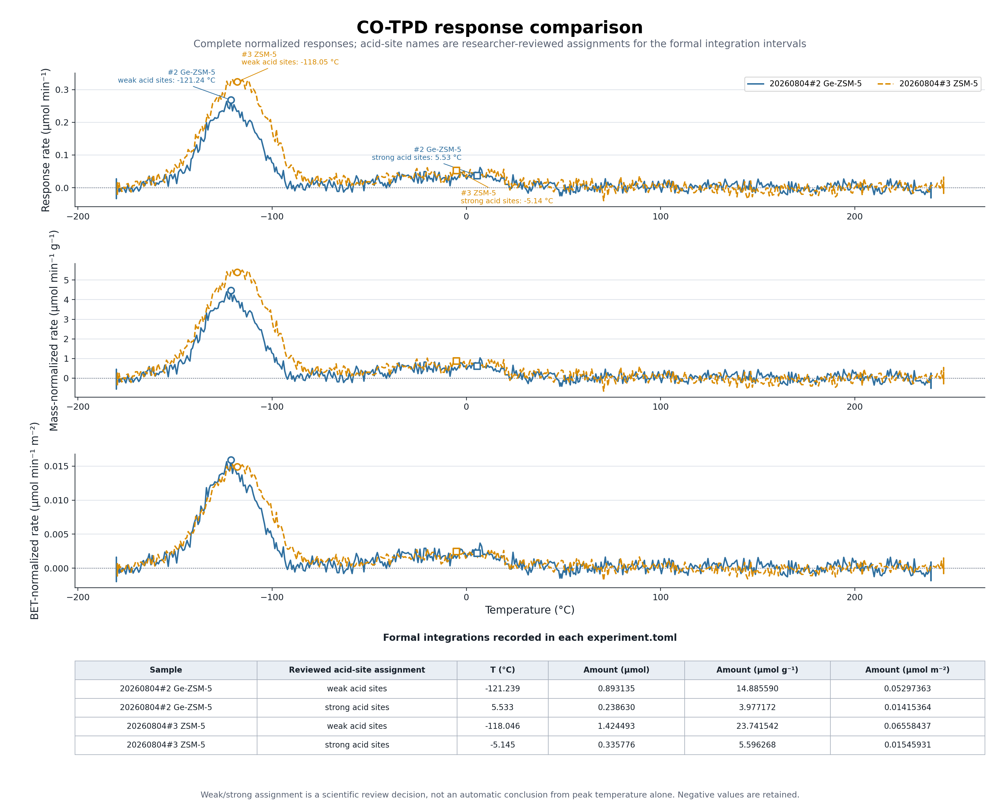

# 20260804 #2/#3 CO-TPD：指数真空、尾段归零与酸位区间对比

本文记录 TPX 0.8、schema 4 对 `20260804#2 Ge-ZSM-5` 与 `20260804#3 ZSM-5` 的一次历史完整复跑。
流程可供参考，但下列数值与窗口只属于当时运行，不能直接沿用为新一轮处理参数。2026-09-08
研究者指出 #3 真空拟合两窗过近，并要求 calibration 平台优先选稳定后段；新一轮结果应以
实验目录 `output0908` 的实际配置、记录与审核材料为准，本文表格不代表该轮结果。

本次始终把原始实验目录视为只读输入：

- 输入：`.../data/20260804#2`、`.../data/20260804#3`
- 输出：`.../output/20260804#2`、`.../output/20260804#3`
- 跨样品比较：`.../output/comparison`
- 工具：`tpdtpd 0.8.0`
- 正式积分身份：`co_integration`

所有 `weak-acid-sites` / `strong-acid-sites` 名称都是研究者审核后的科学归属。候选峰算法只提供中性的候选位置，不能仅凭峰温自动证明酸位强弱。

## 1. 最终结果



图中同时给出绝对、质量归一化和 BET 比表面积归一化响应。蓝色实线与橙色虚线既用颜色也用线型区分；空心圆表示审核为弱酸位的低温特征，空心方块表示审核为强酸位的高温特征。负响应没有裁剪。

| 样品 | 审核归属 | 审核峰温 (°C) | 面积 (µmol) | 质量口径 (µmol g⁻¹) | BET 口径 (µmol m⁻²) |
|---|---|---:|---:|---:|---:|
| #2 Ge-ZSM-5 | 弱酸位 | -121.2393 | 0.89313537 | 14.88558953 | 0.05297363 |
| #2 Ge-ZSM-5 | 强酸位 | 5.53345 | 0.23863030 | 3.97717166 | 0.01415364 |
| #3 ZSM-5 | 弱酸位 | -118.046 | 1.42449254 | 23.74154229 | 0.06558437 |
| #3 ZSM-5 | 强酸位 | -5.14473 | 0.33577611 | 5.59626850 | 0.01545931 |

两区间合计如下：

| 样品 | 合计 (µmol) | 合计 (µmol g⁻¹) | 合计 (µmol m⁻²) |
|---|---:|---:|---:|
| #2 Ge-ZSM-5 | 1.13176567 | 18.86276119 | 0.06712726 |
| #3 ZSM-5 | 1.76026865 | 29.33781078 | 0.08104368 |

以 #2 为参照，#3 的绝对量与质量口径均高 `55.53%`；按 BET 面积归一化后高 `20.73%`。后一个结果只能解释为“每单位 BET 面积的积分 CO 量”，不能直接等同于 CO 位点覆盖度、占有率或酸位密度。

## 2. 两条数据支路必须分开

```text
完整 raw acquisition
  → vacuum subtract
  → fragmentation correct
  → calibration background + adsorption plateau
  → calibration fit

temperature.align 得到的脱附子表
  → vacuum subtract
  → fragmentation correct
  → response_zeroing estimate
  → 人工复核
  → response_zeroing apply
  → relative → composition → flow → rate → normalize
  → integration baseline preview
  → 人工复核 → integration baseline accept
  → neutral peak candidates
  → named interval areas preview
  → 人工复核 → formal interval areas
```

校准支路需要完整标气采集中的“通入目标气之前”和“稳定标气平台”两段。脱附支路只处理与温度程序对齐的升温数据。两条支路共用当前 vacuum 模型、fragmentation 矩阵和最终 calibration 因子，但不能拿 aligned 脱附表重新拟合 calibration，也不能把 calibration background 从脱附曲线中再扣一次。

## 3. 四类基线的边界

| 名称 | 信号域与位置 | 本次用途 | 不能做什么 |
|---|---|---|---|
| `vacuum` | fragmentation 前的逐 AMU 电流 | 从每一行扣除常数或 raw-bound 指数真空电流 | 不能替代物种响应归零或积分基线 |
| `calibration background` | 完整标气采集、fragmentation 后的 CO 响应 | 计算标气平台相对通气前背景的增量和响应因子 | 绝不从脱附曲线中扣除 |
| `response_zeroing` | aligned fragmentation 后、quantify 前的 CO 响应 | 用本样品明确选择的无峰窗口估计一个常数零偏，并从整条 CO 响应相减 | 不是重新测量 vacuum，也不能消除窗内斜率 |
| `integration baseline` | quantify/normalize 后的分析曲线 | 定义正式面积相对于哪条线积分 | 不改变 calibration 或 raw AMU 电流 |

本次 calibration 的核心仍是：

```text
target_plateau_corrected = estimator(target_plateau - target_background)
response_factor = expected_CO_over_Ar / measured_CO_over_Ar
```

这条“标气平台增量”只属于 calibration。出峰的脱附支路不扣除吸附 CO 之前的平台；若解混后的脱附尾段存在常数零偏，使用独立的 `response_zeroing`。

同一样品的弱酸位和强酸位区间共享该样品自己的一条 reviewed zero integration baseline。#2 与 #3 的 response-zero offset、integration baseline 审核和具体数值相互独立，不能跨样品共享。

## 4. 真空模型与选窗

### 4.1 #2 Ge-ZSM-5

Ar 的 `m/z 40` 按本次约定保留默认 `7.04e-15 A`。CO 对应的 `m/z 28` 使用两锚点纯指数：

| 项目 | 数值 |
|---|---:|
| estimator | median |
| 首窗 | 54.1–55.6 min，实际 19 点 |
| 尾窗 | 435.0–443.3 min，实际 106 点 |
| `I1 @ t1` | `1.2973e-10 A @ 54.8209667 min` |
| `I2 @ t2` | `1.2586e-10 A @ 439.1539 min` |
| `k` | `7.8799360808e-5 min⁻¹` |
| `tau = 1/k` | `12690.4583 min` |

因此：

```text
b28(t) = 1.2973e-10 × exp[-7.8799360808e-5 × (t - 54.8209667)] A
```

其余接受的常数模型为：`m2=2.1371e-10`、`m14=3.7721e-12`、`m18=2.0565e-9`、`m44=1.4397e-11 A`。

### 4.2 #3 ZSM-5

`m/z 18` 和 `m/z 28` 分别使用独立指数模型，不能共享窗口统计量：

| AMU | estimator | 首窗 | 尾窗 | `I1 @ t1` (A, min) | `I2 @ t2` (A, min) | `k` (min⁻¹) |
|---:|---|---|---|---|---|---:|
| 18 | mean | 375–383 min，103 点 | 412–432.7 min，265 点 | `1.6739825243e-9 @ 378.9830333` | `1.6376369811e-9 @ 422.3244667` | `5.0647136454e-4` |
| 28 | mean | 373.5–381.5 min，103 点 | 412–432.7 min，265 点 | `1.1290106796e-10 @ 377.4992333` | `1.1095773585e-10 @ 422.3244667` | `3.8733897150e-4` |

常数模型为：`m2=2.18e-10`、`m14=5.13125e-12`、`m40=7.04e-15`、`m44=1.4984e-11 A`。

#3 的完整 raw acquisition 长 `882.2112 min`，实际 TPD 对应的稳定证据集中在约 `373–433 min`。更晚的完整采集后段存在回升，因此这条两锚点纯指数应理解为针对当前 TPD 区段的真空基线模型，而不是解释全部 882 min 仪器漂移的全局物理模型。程序只验证它在完整来源范围内有限并绑定 raw SHA-256，不会把图形看起来合理自动判定为科学接受。

### 4.3 show 与 set 的证据语义

`vacuum show` 只生成 `records/vacuum_baseline_review.json` 和 `vacuum_baseline_review.png`，不改 TOML。因此审核 JSON 保持 `review_status=pending`、`stored=false` 是正常的；它表示“这是一份不可变的审核材料”，不表示模型最后没有使用。

真正的接受证据是随后显式执行 `vacuum set --review-record ...`，并由 TOML 中的指数模型保存相同 review-record 路径与 SHA-256。以后复跑不能只看到一张图就跳过这道门。

## 5. Calibration 选窗与因子

复跑时 mixture plateau（`--adsorption-plateau`）应优先选同一次持续通入混合标气的稳定平台后段，
让吸附有更充分的平衡时间；与切阀和关气边缘留出间隔，并检查目标、内标及其比值的稳定性、有效
点数与窗口时长。后段不稳定或不足时不硬向后推，后段平坦也不自动证明吸附已平衡。先比较 preview
再由研究者决定 final fit；完整指导见[校准选窗原则](../scientific-workflow.md)。下面保留的历史
plateau 与因子不是推荐默认值。

两次实验的标气组成为 CO:Ar = `5:95`，期望摩尔比为 `0.05263157895`。

| 样品 | background | plateau | CO background (A) | CO plateau 增量 (A) | Ar plateau (A) | response factor |
|---|---|---|---:|---:|---:|---:|
| #2 | 80–95 min，median，192 点 | 149.1568–159.0745 min，mean，128 点 | `-2.21608e-12` | `5.81458e-9` | `1.00963274e-7` | `0.9138842331` |
| #3 | 95.2729–105.1908 min，median，128 点 | 139.5515–149.4693 min，mean，128 点 | `-1.19785e-12` | `5.85498e-9` | `1.00944993e-7` | `0.9074150786` |

background 与 plateau 都来自完整 acquisition 的 `calibration_fragmentation.csv`，不是来自 `aligned.csv`。background 只用于计算平台增量；其数值没有被带到脱附曲线里继续相减。

## 6. Response zeroing：#2 为什么改成 24.0–48.8 min

| 样品 | 归零窗口 | 实际点数 | estimator | offset (A) | MAD (A) | 窗内斜率 (A min⁻¹) |
|---|---|---:|---|---:|---:|---:|
| #2 | 24.0–48.8 min | 318 | mean | `+6.187875744e-13` | `8.909736494e-13` | `-4.793958552e-14` |
| #3 | 28.0–48.8 min | 266 | mean | `-4.777863249e-15` | `8.733739050e-13` | `+3.643474664e-14` |

#2 强酸位正式积分的实际程序时间到 `23.3245 min` 结束，归零窗从 `24.0 min` 开始，既避开正式积分区间，又覆盖到采集末端。它实际使用 318 点、跨度约 24.76 min，占整条 aligned 记录约 46%，不再只取最末端少量点，也不由最后几分钟的下移单独决定 offset。

审核图仍显示 #2 窗内有轻微“前段偏正、后段偏负”的下降趋势。常数 `response_zeroing` 的精确定义只是：

```text
CO_zeroed(t) = CO_resolved(t) - mean(CO_resolved in 24.0–48.8 min)
```

所以它保证所选整窗的 mean 数值归零，但不会把 `-4.79e-14 A min⁻¹` 的内部斜率拉平。若未来科研判断要求显式消除物种域漂移，应新增并审核另一种 response-zeroing 模型，不能假装常数 offset 已完成去趋势。

`response_zeroing estimate` 的 JSON/PNG 是 pending 审核材料；显式 `response_zeroing apply` 及其 ProcessingRecord 才是接受和应用的证据。

## 7. 积分基线、候选峰和正式酸位区间

两样品都接受各自的 zero integration baseline：

- #2 审核温区：`-180.2–100 °C`
- #3 审核温区：`-179.7–130 °C`
- 数值方法：trapezoid
- 负值：保留，不裁剪
- 同一样品的两个具名区间：一次 `integration areas` 调用、一个 `co_integration`、一条已审核零基线

候选峰图 `co_candidates_peaks.png` 仍使用中性的算法候选语义。酸位名称只在研究者审核后的正式积分区间中出现：

| 样品 | 正式区间名 | 请求温区 (°C) | 正式峰位 (°C) |
|---|---|---|---:|
| #2 | `weak-acid-sites` | -175 至 -64.7516 | -121.2393 |
| #2 | `strong-acid-sites` | -64.7516 至 50 | 5.53345 |
| #3 | `weak-acid-sites` | -175 至 -56.4164 | -118.046 |
| #3 | `strong-acid-sites` | -56.4164 至 120 | -5.14473 |

这里必须区分两张容易混淆的图：

- `co_integration_baseline.png`：审核“用哪条分析基线、在哪个温区有效”。
- `co_integration_areas.png`：在已接受的基线上预览具名区间、峰位和面积。为了保留计算证据，它也会画出 baseline，但不代表又做了一次基线选择。

正式面积由 `records/co_integration_areas.json` 保存；`records/co_integration_areas_review.json` 与 `co_integration_areas.png` 只是 preview。正式区间不再使用纯编号名称，也不为同一科学结果添加 `fresh`、`final`、`new`、`v2` 等状态后缀。

## 8. BET 信息与换算

质量与 BET 来源是实验目录中的：

```text
data/样品信息#2Ge:ZSM5#3ZSM-5都是60mg.png
SHA-256: 5fde41b3700e285eefd4432c73c47e1d6fdb39c3f847c8b793f09340c4c0bd04
```

| 样品 | 质量 | `S_BET` | 样品总 BET 面积 |
|---|---:|---:|---:|
| #2 Ge-ZSM-5 | 60 mg | 281 m² g⁻¹ | 16.86 m² |
| #3 ZSM-5 | 60 mg | 362 m² g⁻¹ | 21.72 m² |

换算关系为：

```text
amount_umol_m2 = amount_umol / ((mass_mg / 1000) × S_BET)
               = amount_umol_g / S_BET
```

正式 integration record 已保存当时使用的质量、BET 数值与来源；comparison JSON 直接读取正式记录中的 `amount_umol_m2`，不在比较层重新计算并偷偷改变口径。

## 9. 稳定 basename 与工件职责

真实实验复跑应优先保留当前 CLI 的职责型默认 basename，只改变父目录：

```text
aligned.csv
calibration_vacuum.csv
desorption_vacuum.csv
calibration_fragmentation.csv
desorption_fragmentation.csv
response_zeroed.csv
relative.csv
composition.csv
flow.csv
rate.csv
normalized.csv
```

主要审核/正式工件：

```text
records/vacuum_baseline_review.json
vacuum_baseline_review.png
records/co_calibration_preview.json
records/co_calibration_fit.json
records/co_response_zeroing_estimate.json
co_response_zeroing_estimate.png
records/co_integration_baseline_review.json
records/co_integration_baseline_acceptance.json
co_integration_baseline.png
records/co_integration_areas_review.json
co_integration_areas.png
records/co_integration_areas.json
```

比较目录固定保留：

```text
response_comparison.png
area_sum_comparison.json
area_sum_comparison.png
bet_normalized_area_sum_comparison.json
bet_normalized_area_sum_comparison.png
```

若默认目标已存在而 no-clobber 拒绝，不能靠改名添加状态后缀绕过。应由研究者决定使用另一输出父目录，或明确建立新的科学分支，再通过正式命令重建完整谱系。

## 10. 复跑顺序与审核门

以后复跑同类数据时按以下顺序执行，并在每个审核门停下：

1. 在输出目录创建/检查 experiment TOML；不要写入 `data`。
2. `temperature fit` 后人工检查模型，再 `temperature align` 生成 `aligned.csv`。
3. 对每个关注 AMU 显式选择 `constant` 或 `exponential`；`vacuum show` 后看完整 raw、选窗、模型和扣后曲线，再 `vacuum set`。
4. 分别对完整 raw 和 aligned 子表执行 `vacuum subtract → fragmentation correct`。
5. 只在完整 acquisition 支路执行 calibration preview/fit。
6. 只在 aligned 脱附支路执行 `response_zeroing estimate`；检查完整峰形、窗口点数、offset、MAD/SD 和窗口斜率，再显式 apply。
7. 依次生成 `relative → composition → flow → rate → normalized`，不要跳过中间表。
8. preview 并 accept 每个样品自己的 integration baseline。
9. 候选峰保持中性；由研究者决定具名弱酸位/强酸位区间。
10. 先运行 areas preview，复核后用相同 `co_integration` 和相同区间运行正式 areas。
11. 比较图只读取当前 SHA-256 可验证的正式 integration record 与 normalized CSV。
12. 最后核对 TOML、ProcessingRecord、输入/输出 SHA-256 和目录卫生；哈希完整只证明谱系一致，不等于科学真值。

本次两样品各有 11 条 ProcessingRecord，最终核对均为 `11/11 verified`。关键正式输入 SHA-256 为：

| 样品 | `normalized.csv` | `records/co_integration_areas.json` | 当前 `experiment.toml` |
|---|---|---|---|
| #2 | `8400f8b4…accc` | `20259a53…b79cf` | `91cef23a…9c32d` |
| #3 | `cef75925…43a2` | `11a2f0e0…7530` | `bf176727…6f050` |

## 11. 本次最重要的经验

- 真空扣除应逐 AMU 选择模型；CO 和水可以使用各自的指数锚点，Ar 仍可保留明确约定的常数。
- 指数 vacuum 是 fragmentation 前、绑定 raw SHA-256 的仪器背景模型；response zeroing 是 fragmentation 后、本样品本物种的常数零偏，两者不能混写。
- 零点窗口要在完整曲线上审核。#2 的 `24.0–48.8 min` 比只取最末端少量点更能代表整段峰后响应，但常数归零只居中，不消除漂移。
- calibration background 只修正标气平台增量，不应被拿到脱附出峰支路再扣一次。
- 一个样品的弱/强酸位区间可以共享一条 reviewed integration baseline；两个样品不能共享具体 offset 或 baseline 数值。
- 低温/高温特征到弱/强酸位的映射是研究者审核归属，不是候选峰算法结论。
- BET 归一化改变的是分母和比较口径，不自动给出位点覆盖度。
- 默认 basename、稳定 result ID、ProcessingRecord 和 SHA-256 是复跑身份的一部分，不应被临时状态命名破坏。

更一般的数学关系和命令职责见[TPD 数据处理关键逻辑：校正、响应标定、定量与峰面积](几种校正的对比.md)。
